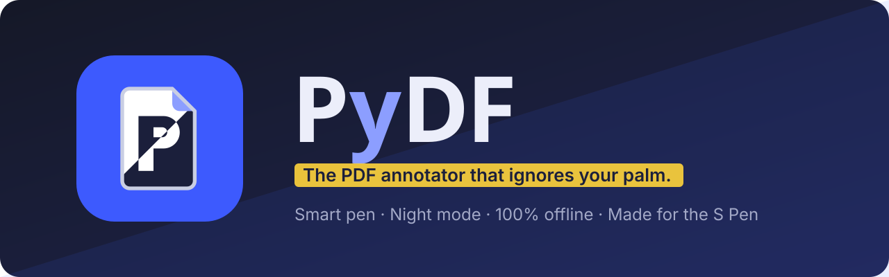

  

  
  
  
  

<h3 align="center">Rest your hand. Write like it's paper.</h3>

PyDF is a fast, beautiful PDF reader and annotator built for Samsung tablets and phones with the S Pen. 
Your palm never draws, never scrolls, never zooms. The pen just writes.

---

## Why PyDF

Most PDF apps make you hover your hand above the screen like it's hot. PyDF was built the other way round: **your palm is invisible to the page**. Fingers move the page, the pen marks it, and the two never get confused.

Then it goes further. The pen understands what you mean. Swipe along a line of text and it becomes a crisp highlight. Write a note in the margin and it stays ink. No mode switching, no menus, no thinking.

## Features

### ✍️ The Smart Pen
- **Swipe along a line → highlight.** PyDF recognises a horizontal swipe on text and snaps a clean highlight to the exact characters.
- **Write anywhere else → ink.** Circles, underlines, arrows and handwriting stay as ink, even right on top of the text.
- **Press, then swipe.** Rest the pen on a word for a moment and you feel a tap. Everything you sweep through next is highlighted.
- **Pressure-sensitive ink** that follows the pen tip without lag.
- **Side button = eraser.** Hold the S Pen button and sweep: whole strokes and highlights disappear.

### 🖐️ Palm rejection that actually works
- A resting palm **never** draws, scrolls, zooms or selects anything.
- While the pen hovers or touches the screen, fingers are ignored completely.
- Tuned on real hardware, for real handwriting sessions.

### 📖 Reading, the way you like it
- **Smooth continuous scrolling** with one finger or two, plus fling.
- **Pinch to zoom** up to 5×, crisp at every level.
- **🔒 Lock:** freeze zoom and rotation for distraction-free reading in bed or on the go.
- **Scroll bar:** switch on a draggable scroll bar to fly through long documents.
- **Document outline:** jump straight to any chapter or section from the sidebar.
- **Page thumbnails** in a slide-out panel.
- **Remembers your place** in every document.

### 🌙 Night mode
One tap turns pages dark for comfortable reading at night. Colours keep their meaning: blue stays blue and your highlights stay highlights. Your file is never changed.

### 🔤 Select, copy, highlight
Long-press any word with your finger to select it, then drag the handles. A floating bar lets you **highlight in six colours**, **copy** the text, **select all** or **remove** an existing highlight.

### 🗂️ Pages
- Insert blank pages before, after or at the end, in seven paper colours, including a dark charcoal.
- Delete pages you don't need.
- Every action can be undone and redone.

### 💾 Your files, safe
- Annotations are saved as **standard PDF annotations**, so they show up in any other PDF viewer.
- Open a file again and every stroke and highlight is still editable.
- **Crash-proof:** unsaved work is kept automatically and offered back to you.
- Saves are atomic. Your original PDF is never left half-written.
- Read-only file? PyDF offers to save a copy instead.
- Password-protected PDFs are supported.

### 🎨 Made to feel calm
A clean single toolbar, big finger-friendly buttons, light and dark themes, and portrait and landscape layouts.

## 100% offline. For real.

PyDF has **no internet permission**. Android won't let it connect anywhere, even if it wanted to.

- No accounts
- No ads
- No analytics or tracking
- No cloud
- Works in airplane mode, in a basement, on a plane

Your documents and your notes stay on your device. Full stop.

## Get it

1. Download **`PyDF-v1.0.0.apk`** from the [latest release](https://github.com/o7PY/PyDF/releases/latest).
2. Open it on your tablet and allow installing from this source when Android asks.
3. Open any PDF, from the app or with **Open with → PyDF** in your file manager.

## Made for the S Pen. Only the S Pen.

PyDF is built exclusively for **Samsung Galaxy tablets and phones with an S Pen**: the magnetic, battery-free stylus that Samsung uses. It's designed and tuned around how the S Pen talks to the screen, including its hover and its side button.

- ✅ **Galaxy Tab** with S Pen (made and tuned on the Galaxy Tab S6 Lite)
- ✅ **Galaxy phones** with S Pen (Galaxy Note series, Galaxy S Ultra)
- ✅ Android 11 or newer
- ❌ Not supported: devices without an S Pen, capacitive or universal styluses, and Bluetooth-only pens

No S Pen, no PyDF: palm rejection and the smart pen depend on it.

## Quick guide

| You do | PyDF does |
|---|---|
| Swipe the pen along a line of text | Highlights it |
| Write, draw, circle or underline | Ink |
| Rest the pen on text, then swipe | Highlights everything you sweep |
| Hold the S Pen button and sweep | Erases whole strokes |
| One or two fingers | Scroll |
| Pinch | Zoom |
| Long-press a word | Select, copy, highlight |
| Tap 🔒 | Lock zoom and rotation |
| Tap ◐ | Night mode |

## Tech stack

| | |
|---|---|
| Language | Kotlin |
| Interface | Jetpack Compose, Material 3 |
| Page canvas | Custom Android View with direct stylus input |
| PDF engine | MuPDF |
| Low-latency ink | AndroidX Motion Prediction |
| Storage | Room, DataStore |
| Concurrency | Kotlin Coroutines |
| Platform | Android 11+ (API 30), optimised for API 35 |

## License

PyDF is open source under the [GNU AGPL v3](LICENSE). PDF rendering is powered by [MuPDF](https://mupdf.com) by Artifex Software.
